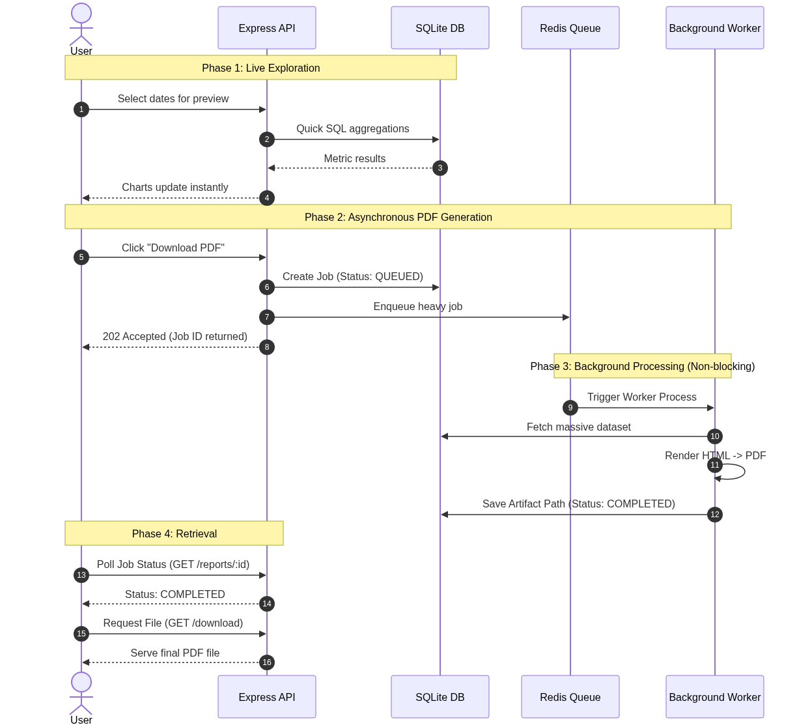
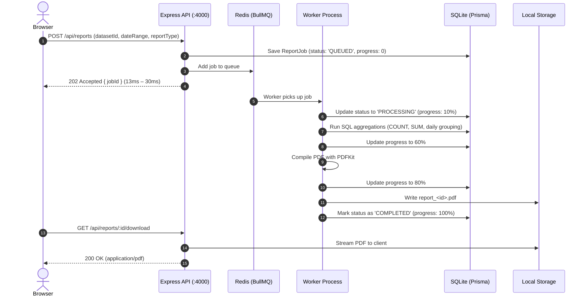
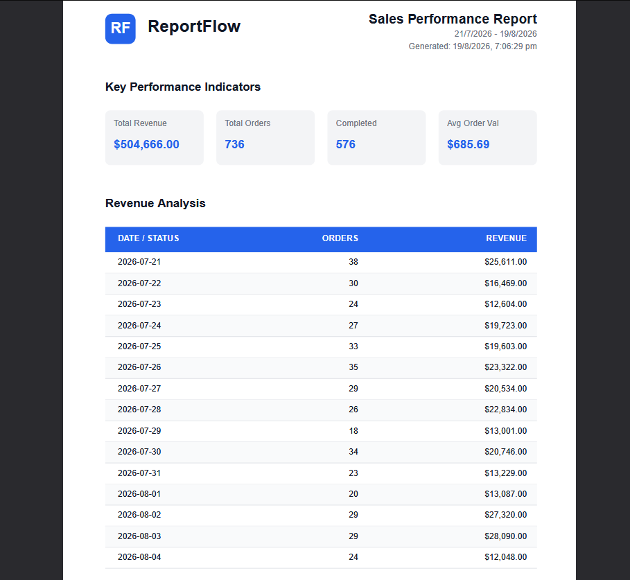

# ReportFlow

Background PDF report generator built with Node.js, Express, BullMQ, Redis, and Next.js.

<p align="left">
  <a href="https://github.com/nareshchandu17/report-flow/actions/workflows/ci.yml"></a>
  
  
  
  
  
  
</p>

---

## Overview

Generating PDF reports synchronously inside an HTTP request blocks the Node.js event loop and leads to timeouts as datasets grow. 

ReportFlow offloads report generation to background workers using a Redis-backed BullMQ queue. The API accepts requests and returns in **under 30ms**, while background workers handle SQL aggregation and stream PDF files to disk.



---

## Performance (Tested on 5,000–6,000 Records)

Measured with automated end-to-end trials under [`scripts/benchmark-5000-records.js`](./scripts/benchmark-5000-records.js). Full log traces are available in [`docs/benchmarks/5000-record-verification.md`](./docs/benchmarks/5000-record-verification.md).

| Metric | Result | Notes |
|---|---|---|
| **API Response Time** | **13.39 ms – 30.71 ms** | `POST /api/reports` enqueues job and returns `202 Accepted` immediately |
| **Tested Record Volume** | **5,000 – 6,000 rows / job** | Verified across multiple runs |
| **Background Processing Time** | **216 ms – 223 ms** | SQL aggregation + PDFKit compilation + file write |
| **Data Accuracy** | **100% match** | Raw SQLite sums matched computed metrics down to the cent; 0 dropped records |
| **Worker Concurrency** | **5 jobs in parallel** | Worker pool limit per process |
| **CSV Ingestion Speed** | **814 ms (5,000 rows)** | Inserted in 100-record transactional batches |

To run the benchmark yourself:
```bash
npm run test:benchmark
```

---

## Architecture

```
┌─────────────┐      ┌─────────────┐      ┌─────────────┐      ┌─────────────┐
│   Web UI    │─────>│   Express   │─────>│    Redis    │─────>│   Worker    │
│  (Next.js)  │      │     API     │      │  (BullMQ)   │      │ (Processor) │
└─────────────┘      └─────────────┘      └─────────────┘      └─────────────┘
                            │                                           │
                            ▼                                           ▼
                     ┌─────────────┐                           ┌─────────────┐
                     │   SQLite    │                           │    Disk     │
                     │  (Prisma)   │                           │ (PDF Files) │
                     └─────────────┘                           └─────────────┘
```

### How a Report is Generated



---

## Key Technical Decisions

- **Queue-based execution (BullMQ + Redis)**: API routes only validate payloads and push job IDs into Redis. Workers process jobs independently, reporting progress milestones (`10%` &rarr; `60%` &rarr; `80%` &rarr; `100%`) so the UI can show live status.
- **In-database aggregations**: Metrics like revenue, completed orders, and daily breakdowns run directly in SQLite via SQL queries, preventing memory spikes from loading thousands of rows into Node.js.
- **Streaming PDF writes**: PDFKit streams generated pages directly to disk rather than buffering complete files in RAM.
- **Defensive limits**: CSV uploads are capped at 10,000 rows to prevent heap exhaustion. Database inserts run in 100-row chunks inside transactions.
- **Cleanup on failure**: If a report job fails mid-generation, any partially written file on disk is deleted automatically.
- **Graceful shutdown**: Workers catch `SIGTERM` signals and finish active jobs before closing Redis connections.
- **URL-synced UI state**: The Next.js 16 frontend keeps pagination (`?page=2`) and filters in sync with the browser URL.

---

## Project Structure

```
report-flow/
├── apps/
│   ├── api/          # Express REST API (auth, datasets, reports)
│   ├── web/          # Next.js 16 dashboard (charts, filters, report history)
│   └── worker/       # Background worker (BullMQ job consumer + PDFKit)
├── packages/
│   ├── database/     # Prisma schema, migrations, seed, queries
│   └── shared/       # Shared TypeScript types and Zod schemas
├── docs/benchmarks/  # Benchmark documentation and logs
├── scripts/          # Benchmark reproduction scripts
└── docker-compose.yml
```

---

## Quickstart

### Prerequisites
- Node.js 20 or 22
- Docker (for Redis)
- npm 10+

### 1. Install dependencies
```bash
git clone https://github.com/nareshchandu17/report-flow.git
cd report-flow
npm install
```

### 2. Set up environment
```bash
cp .env.example .env
```

Ensure `.env` contains:
```env
DATABASE_URL="file:./report.db"
REDIS_URL="redis://127.0.0.1:6390"
PORT=4000
NEXT_PUBLIC_API_URL="http://localhost:4000/api"
JWT_SECRET="your-jwt-secret-key"
```

### 3. Start Redis and seed the database
```bash
docker compose up -d
npm run build:packages
npm run db:seed
```

### 4. Run the app
```bash
npm run dev
```

- **Frontend**: http://localhost:3000
- **API**: http://localhost:4000
- **Worker**: Runs in the background and listens for queue jobs

---

## API Summary

| Endpoint | Method | Description |
|---|---|---|
| `/api/auth/register` | `POST` | Register user account |
| `/api/auth/login` | `POST` | Login & receive JWT token |
| `/api/datasets` | `GET` | List user's datasets |
| `/api/datasets/create` | `POST` | Import CSV dataset with column mapping |
| `/api/reports` | `POST` | Queue a report job (returns `202 Accepted` with `jobId`) |
| `/api/reports` | `GET` | List user's generated reports (paginated) |
| `/api/reports/:id` | `GET` | Get report job status & progress percentage |
| `/api/reports/:id/download` | `GET` | Download generated PDF file |
| `/api/reports/:id` | `DELETE` | Delete report record and its file from disk |

---

## Testing

```bash
# Run unit and integration tests across all workspaces
npm test

# Run the 5,000-record benchmark test
npm run test:benchmark

# Build all packages and applications in dependency order
npm run build
```

---

## Sample Report



---

## License

MIT
