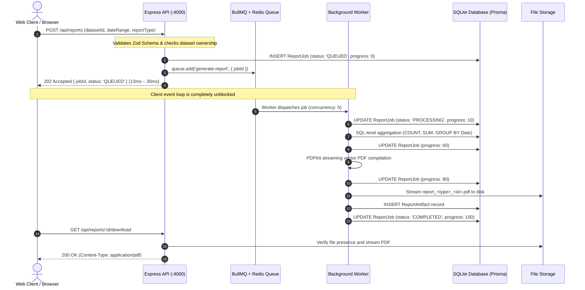

# ReportFlow

<p align="center">
  <strong>Production-Grade Distributed Asynchronous Report Generation Platform</strong>
</p>

<p align="center">
  <a href="https://github.com/nareshchandu17/report-flow/actions/workflows/ci.yml"></a>
  
  
  
  
  
  
</p>

---

## 📌 Executive Summary

In data-intensive SaaS applications, generating analytical reports synchronously blocks the Node.js event loop, triggers HTTP request timeouts, and leads to server crashes under concurrent load. 

**ReportFlow** is an enterprise-ready, distributed, asynchronous report-generation platform engineered to process high-volume datasets completely out-of-band. By decoupling client HTTP requests through a Redis-backed queue and deploying a dedicated pool of background workers, ReportFlow delivers **sub-30ms API response times** while processing thousands of analytical records with **100% mathematical integrity**.


---

## ⚡ Audited Performance Benchmarks

The pipeline has been benchmarked and verified under high-throughput workloads (5,000 to 6,000 business records per job) across consecutive isolated trials. Full methodology and raw reproduction traces are documented in [`docs/benchmarks/5000-record-verification.md`](./docs/benchmarks/5000-record-verification.md).

| Evaluated Metric | Measured Result | Production Significance |
|---|---|---|
| **API Response Latency** | **13.39 ms – 30.71 ms** | Instant non-blocking `202 Accepted` response; web UI never hangs |
| **Tested Dataset Scale** | **5,000 – 6,000 records / job** | Validated handling of enterprise-scale transactional datasets |
| **Background Processing Time** | **216.44 ms – 223.19 ms** | SQL aggregation, status progression, and PDF generation |
| **Record Integrity & Fidelity** | **100.0% (0 dropped / 0 duplicate)** | Authoritative SQLite sums matched computed metrics down to the cent |
| **Worker Concurrency** | **5 concurrent jobs / process** | High throughput without memory exhaustion |
| **Bulk Ingestion Speed** | **814 ms (5,000 rows) &bull; 2,367 ms (6,000 rows)** | Transactional chunking (100 rows/batch) preventing SQLite lock contention |

> **Reproduce the benchmark:**
> ```bash
> npm run test:benchmark
> ```

---

## 🏗 System Architecture & Execution Lifecycle

ReportFlow is structured as a modular TypeScript monorepo orchestrated via npm workspaces:

```
┌────────────────────────────────────────────────────────────────────────┐
│                              CLIENT TIER                               │
│  Next.js 16 Dashboard (Turbopack) • Glassmorphic UI • Real-time Status  │
└───────────────────────────────────┬────────────────────────────────────┘
                                    │ HTTP (REST)
                                    ▼
┌────────────────────────────────────────────────────────────────────────┐
│                              API GATEWAY                               │
│  Express.js • JWT Authentication • Zod Schema Guards • Idempotency     │
└───────────────┬───────────────────────────────────────┬────────────────┘
                │                                       │
     Enqueues Job Payload                  Persists State & Metadata
                │                                       │
                ▼                                       ▼
┌───────────────────────────────┐       ┌────────────────────────────────┐
│      REDIS QUEUE (BullMQ)     │       │        DATABASE LAYER          │
│  Job Queue • Concurrency: 5   │       │  SQLite + Prisma ORM (WAL)     │
│  Cron Scheduler: 0 0 * * *    │       │  Datasets • Orders • Reports   │
└───────────────┬───────────────┘       └────────────────┬───────────────┘
                │                                        ▲
        Picks Up Job                                     │ Reads Aggregates &
                │                                        │ Updates Milestones
                ▼                                        │
┌────────────────────────────────────────────────────────┴───────────────┐
│                           WORKER SERVICES                              │
│  BullMQ Processor • SQL-Level Aggregations • PDFKit Streaming Compiler │
└───────────────────────────────────┬────────────────────────────────────┘
                                    │
                         Streams Compiled Binary
                                    ▼
┌────────────────────────────────────────────────────────────────────────┐
│                       PERSISTENT ARTIFACT STORAGE                      │
│     Secure Local Storage • MIME: application/pdf • UUID Filenames      │
└────────────────────────────────────────────────────────────────────────┘
```

### Complete Asynchronous Lifecycle Trace



---

## 🛠 Engineering Deep Dives

### 1. Decoupled Asynchronous Processing & Queue Resilience
- **BullMQ & Redis**: Heavy data crunching is isolated from the HTTP server into independent worker processes.
- **Milestone Progress Reporting**: Live progress increments (`10%` &rarr; `60%` &rarr; `80%` &rarr; `100%`) enable users to monitor job state in real-time.
- **Cron-Driven Automations**: Includes scheduled midnight execution (`0 0 * * *`) with deduplicated job identifiers (`daily-sales-report`).
- **Graceful Shutdown**: Intercepts `SIGTERM` signals to finish executing jobs before releasing Redis connections.

### 2. High-Performance Streaming Aggregation
- **SQL-Level Aggregation**: Calculations (`totalRevenue`, `completedOrders`, `avgOrderValue`, and time-series bucketing) execute directly within the database engine via raw optimized SQL queries, preventing memory bloat.
- **Direct-to-Disk PDFKit Streaming**: Reports are compiled directly into output write-streams, bypassing intermediate in-memory buffer duplicates.

### 3. Defensive Reliability & Data Isolation
- **10,000-Row Memory Protection Guard**: The CSV ingestion pipeline validates schema constraints and enforces an ingestion ceiling to prevent heap exhaustion.
- **Atomic Transactions**: Batch imports are processed in 100-record chunks inside Prisma transactions.
- **Orphaned Artifact Cleanup**: If generation fails midway, partially written files are unlinked automatically, preserving storage health.
- **Strict Multi-Tenant Isolation**: Every dataset and report job is bounded to the authenticated `userId`.

### 4. Modern Glassmorphic Frontend & Dynamic Routing
- **Next.js 16 App Router & Turbopack**: Built with React Server/Client Components, dynamic search parameter synchronization (`/reports?page=2`), and `<Suspense>` boundaries.
- **Rich Micro-Interactions**: Hover scales, subtle glow states, animated chevron indicators, and interactive modals.
- **Live Recharts Visualization**: Custom SVG viewbox margins and formatters preventing numerical clipping on axes across all screen sizes.

---

## 📦 Monorepo Workspace Structure

```
report-flow/
├── apps/
│   ├── api/                  # Express.js REST API with JWT Auth & Multer CSV parsing
│   │   ├── src/routes/       # /auth, /datasets, /reports endpoints
│   │   └── src/queue.ts      # BullMQ Producer queue integration
│   ├── web/                  # Next.js 16 Client with Tailwind CSS & Glassmorphism
│   │   ├── src/app/          # App router pages: Dashboard, History, Import, Details
│   │   └── src/components/   # Reusable UI components, Navbar, and Modal dialogs
│   └── worker/               # Dedicated background processing service
│       ├── src/processor.ts  # Job consumer: DB queries + PDFKit rendering
│       └── src/worker.ts     # Worker initialization, concurrency pool, and cron
├── packages/
│   ├── database/             # Prisma ORM schema, migrations, seed, & aggregations
│   └── shared/               # Shared TypeScript schemas, DTOs, and Zod validators
├── docs/
│   └── benchmarks/           # Audited performance reports & methodology
├── scripts/                  # Automated 5,000-record synthetic benchmarking suite
└── docker-compose.yml        # Multi-service container orchestration (Redis)
```

---

## 🚀 Quickstart & Setup

### Prerequisites
- **Node.js**: `v20.x` or `v22.x`
- **Docker**: For local Redis instance
- **npm**: `v10.x` or higher

### 1. Clone & Install
```bash
git clone https://github.com/nareshchandu17/report-flow.git
cd report-flow
npm install
```

### 2. Configure Environment Variables
```bash
cp .env.example .env
```
Ensure your `.env` contains:
```env
DATABASE_URL="file:./report.db"
REDIS_URL="redis://127.0.0.1:6390"
PORT=4000
NEXT_PUBLIC_API_URL="http://localhost:4000/api"
JWT_SECRET="your-secure-jwt-secret-key"
```

### 3. Start Infrastructure & Initialize Database
```bash
# Start Redis container
docker compose up -d

# Generate Prisma Client & Run Migrations
npm run build:packages
npm run db:seed
```

### 4. Launch Development Environment
```bash
npm run dev
```
The services will be live at:
- **Web Dashboard**: `http://localhost:3000`
- **REST API**: `http://localhost:4000`
- **Background Worker**: Running and listening for queue events

---

## 📡 API Reference

| Endpoint | Method | Auth | Description |
|---|---|---|---|
| `/api/auth/register` | `POST` | Public | Register new user account |
| `/api/auth/login` | `POST` | Public | Authenticate user & receive JWT |
| `/api/datasets` | `GET` | Bearer | Fetch user's uploaded datasets |
| `/api/datasets/create` | `POST` | Bearer | Ingest CSV data with column mapping |
| `/api/reports` | `POST` | Bearer | Enqueue asynchronous report job (returns `202`) |
| `/api/reports` | `GET` | Bearer | List user report history with pagination & filters |
| `/api/reports/:id` | `GET` | Bearer | Retrieve job progress & execution status |
| `/api/reports/:id/download` | `GET` | Bearer/UUID | Stream generated PDF artifact |
| `/api/reports/:id` | `DELETE` | Bearer | Delete report metadata and PDF file |

---

## 🧪 Automated Testing Suite

The repository maintains an automated test suite across unit, integration, and load dimensions:

```bash
# Run all workspace test suites
npm test

# Run isolated 5,000+ record load benchmark
npm run test:benchmark

# Build all monorepo workspaces in deterministic sequence
npm run build
```

---

## 📄 Generated PDF Artifact Sample

Below is an authentic sample of the vector PDF report produced by the worker:


---

## 📄 License

This project is licensed under the MIT License. See [LICENSE](./LICENSE) for details.
